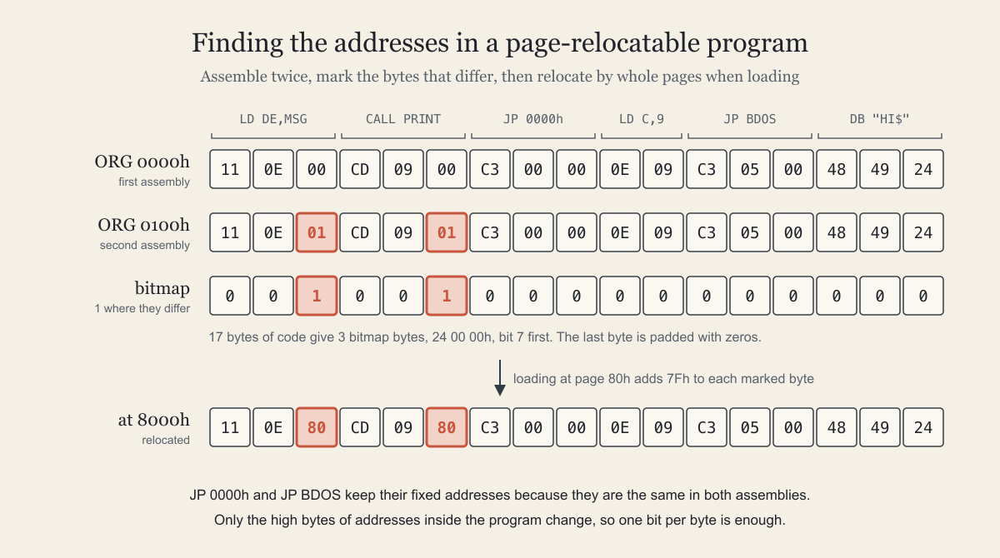

# Relocating Z80 programs one bit at a time

By John Hardy

<figure>
  <picture>
    <source srcset="./assets/prl-hero.svg" type="image/svg+xml">
    
  </picture>
  <figcaption>Assembling a program twice finds every byte that holds part of an internal address. This illustration is public domain.</figcaption>
</figure>

Most Z80 programmers know the CP/M COM file inside out. Far fewer have met its cousin the PRL file, which Digital Research used in MP/M and CP/M 3 for code that had to run at an address nobody knew in advance. I needed exactly that for [TEC-OS](https://debug80.com/tec-os/), the CP/M-compatible operating system I've been writing for the TEC-1G, and the more I worked with PRL the more I admired it. It solves a hard problem on an 8-bit machine with almost no machinery. There's no linker and no symbol table, and the relocation loop takes 26 bytes of Z80 code.

## The COM file

A COM file is the simplest executable format there is. It has no header, no signature and no metadata of any kind. The file is a memory image of the program, byte for byte, and CP/M's command processor loads it at address 0100h and jumps to its first byte. That's the whole specification.

The address 0100h comes from the layout of a CP/M machine. The first 256 bytes of memory, page zero, belong to the system. They hold the jump to warm boot at 0000h, the jump into the BDOS at 0005h, the default file control blocks at 005Ch and the command tail at 0080h. The program area, the transient program area or TPA, starts straight after it and runs up to the BDOS. A program finds the top of its memory by reading the address in the jump at 0005h.

Because every COM program loads at the same place, the assembler can work out every address in the program before it ever runs. If a program says `CALL PRINT` and `PRINT` ends up at 0109h, the assembler writes `CD 09 01` and that's final. The convention was strong enough that MS-DOS kept it for its own COM files, which also start 100h bytes into their memory segment.

## Absolute addresses

The weakness of a COM file is that its code is welded to 0100h. Move it anywhere else and it breaks, because the Z80 instruction set is full of absolute addresses. `JP`, `CALL`, `LD HL,nn`, `LD A,(nn)` and every `DW` in a table all name a fixed 16-bit location. When the code moves, those numbers still point at the old place.

The Z80 offers very little help here. `JR` and `DJNZ` use a displacement relative to the current instruction, so they keep working wherever the code lands, but they only reach about 128 bytes in either direction and are only available as jumps. There is no relative `CALL` and no way to load data relative to the program counter. A real program can't be written from relative branches alone, so in practice Z80 code is tied to the address it was assembled for.

The traditional answer is a linker. An assembler such as Microsoft's M80 or Digital Research's RMAC writes a relocatable object file, a REL file, in which every address is recorded relative to the start of its module along with the names of external symbols. The linker reads the modules, decides where each one goes, patches every address and writes out an ordinary COM file. That works well, but all the relocation happens before the program runs. The output is still welded to 0100h. Relocating a program when it loads, to wherever memory happens to be free, needs a different idea.

## The PRL idea

Digital Research's answer was to make the problem smaller. A PRL program can be loaded anywhere at all as long as the address is on a page boundary, a multiple of 256.

If a program moves by a whole number of pages, the low byte of every address in it stays the same. A routine at 0109h moved up by 7F00h lands at 8009h. Its low byte is still 09h and only the high byte has changed, from 01h to 80h. So the loader can skip working out where the addresses are or how long they are. It only requires the set of bytes that hold the high bytes of internal addresses, and it adds the same number to each of them.

That's a yes or no question for every byte, which means it takes one bit per byte to answer. A PRL file carries the program's code followed by a bitmap with one bit for each byte of code. A set bit marks a byte to adjust. The overhead is an eighth of the code size, and the loader never has to decode a Z80 instruction.

## Finding the addresses

The clever part is how to build the bitmap without a relocating assembler. You assemble the program twice, once at origin 0000h and once at 0100h, and compare the two images byte by byte. Most bytes come out identical. A byte that holds the high half of an internal address is exactly one greater in the second image, because the second assembly put everything one page higher. Every byte that differs gets a bit in the bitmap.

Here is a small CP/M program that prints `HI` by calling a subroutine:

```asm
BDOS    EQU     $0005
        ORG     $0100
START:  LD      DE,MSG
        CALL    PRINT
        JP      $0000
PRINT:  LD      C,9
        JP      BDOS
MSG:    DB      "HI$"
```

[Atom](https://semantic-scroll.com/content/2026/09/04/01-atom-my-z80-assembler/), my Z80 assembler, turns it into 17 bytes. These are the two images:

```text
offset   00 01 02 03 04 05 06 07 08 09 0A 0B 0C 0D 0E 0F 10
0000h    11 0E 00 CD 09 00 C3 00 00 0E 09 C3 05 00 48 49 24
0100h    11 0E 01 CD 09 01 C3 00 00 0E 09 C3 05 00 48 49 24
```

Only two bytes differ. Offset 2 is the high byte of `MSG` in `LD DE,MSG` and offset 5 is the high byte of `PRINT` in `CALL PRINT`. Both go from 00h to 01h. The low bytes, 0Eh and 09h, are the same in both images.

`JP $0000` and `JP BDOS` refer to locations in page zero that stay put whatever happens to the program. They assemble to the same bytes both times, so they get no mark and the loader leaves them alone. Telling internal addresses from fixed ones is exactly what a relocating loader has to get right, and the double assembly gets it right for free. The assembler has already worked out which values are labels in the program and which are plain numbers. Comparing the two images reads that result straight out of the output.

The bitmap has a 1 at offsets 2 and 5 and a 0 everywhere else. Bit 7 of the first bitmap byte stands for the first byte of code, bit 6 for the second and so on. Seventeen bytes of code need three bitmap bytes, `24 00 00`, and the unused bits at the end of the last one are zero.

The comparison also catches code that can't be relocated by page. Some uses of an address can't be fixed by adding a page, such as multiplying it by two. In `LD HL,MSG * 2` the high byte differs by two between the images, so the tool that builds the bitmap reports it as an error. Taking the high byte of an address on purpose is fine. A shift right by eight gives a byte that differs by exactly one, and it gets marked like any other high byte.

The idea goes back a long way. In 1978 Dr. Dobb's Journal described a loader that read two hex files, one assembled at 0 and one at 100h. Digital Research's LINK-80 could also write PRL files straight from REL files with its `[OP]` option. The two-assembly method still works with any assembler that can change its origin, including Atom.

## The file format

The CP/M 3 Programmer's Guide gives the format in its Appendix B. A PRL file has three parts:

```text
0000h        header page, 256 bytes
               0001h-0002h  length of the code
               0004h-0005h  extra memory the program needs beyond its code
               every other byte reserved
0100h        the code, assembled for origin 0100h
0100h + n    the bitmap, one bit per byte of code, bit 7 first
```

The code in the file is the image assembled at 0100h, not the one at 0000h. If the whole file were loaded at 0000h, the code would sit exactly where a COM program does. A PRL program loaded at the usual 0100h therefore needs no relocation at all, and CP/M 3's command processor simply runs a PRL as if it were a COM file. Digital Research also had a sister format, SPR, with the same layout and the code assembled at 0000h. CP/M 3 used SPR files for its own BDOS and BIOS.

The two are easy to confuse, and I did. My first version of TEC-OS stored the 0000h image under the PRL name, which is really SPR's convention. It worked perfectly with my own files and would have loaded a genuine PRL from LINK-80 one page out. The manual is explicit about the 0100h origin, and checking it before writing the loader would have saved me the fix.

## Loading at any page

To load a PRL program at page `p`, a loader reads the header for the code length, puts the code at `p` × 256 and adds `p - 1` to every byte whose bitmap bit is set. The 1 comes off because the code was assembled for page 1. For the example program at 8000h the loader adds 7Fh, so both marked bytes become 80h and `LD DE,MSG` and `CALL PRINT` now point into the relocated copy. `JP $0000` and `JP BDOS` keep their original addresses. The illustration at the top shows all four stages.

The loop that does the work is short enough to show in full. It walks the code and the bitmap together and shifts one bit out for each byte. A marker bit takes the place of a separate counter for the eight bits in each bitmap byte:

```asm
; Relocate BC bytes of code at HL, adding E to each byte whose bit is set
; in the bitmap at IX.
RELOC:  LD      D,0             ; no bitmap bits in hand yet
NEXT:   LD      A,B             ; stop when the count reaches zero
        OR      C
        RET     Z
        SLA     D               ; the next bit goes into carry
        JR      NZ,TEST         ; D still holds the marker, so the bit is real
        LD      A,(IX+0)        ; fetch the next eight bits
        INC     IX
        SCF                     ; a marker bit enters at bit 0
        RLA                     ; and bit 7 goes into carry
        LD      D,A
TEST:   JR      NC,SKIP         ; an unmarked byte stays as it is
        LD      A,(HL)
        ADD     A,E             ; a marked byte gets the page offset
        LD      (HL),A
SKIP:   INC     HL
        DEC     BC
        JR      NEXT
```

When a fresh bitmap byte is loaded, `SCF` and `RLA` shift its top bit into carry and put a 1 into bit 0 behind the remaining seven bits. Each later `SLA D` shifts out the next bit. After the seventh, only the marker is left in D, and the next shift pushes it out and leaves D at zero. That zero sends the loop back to fetch another bitmap byte. The routine is 26 bytes long. I ran it on a Z80 emulator against the example above and a few hundred random programs and bitmaps. Some had lengths that aren't a multiple of eight, and every result matched a reference implementation.

The arithmetic works modulo 256, so the loader never needs to check for overflow. Once the code is relocated the bitmap and header can be thrown away, and the program in memory is indistinguishable from one assembled for that address in the first place.

That's what makes PRL so useful on a small machine. MP/M used it to run programs in whatever memory segment was free. CP/M 3 used it for resident system extensions, which load just below the BDOS at an address that depends on what else is installed. TEC-OS uses it the same way, to install resident programs below the BDOS and lower the top of memory for everything that runs after them. In each case the program is assembled once by an ordinary assembler, and the operating system picks its address at load time. That's a remarkably good deal for one bit per byte, and I think PRL should be far better known among Z80 programmers than it is.
